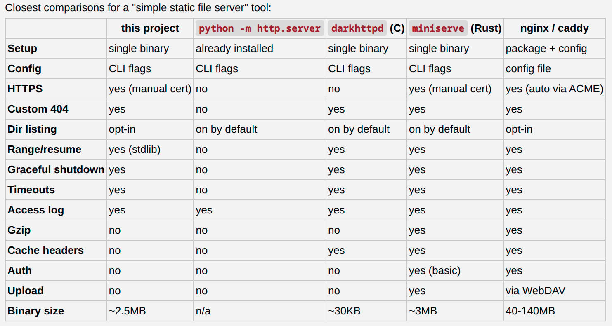

# what
- a tiny static file server, binary is 2.3MB
- serves index.html over HTTP or HTTPS + custom `404.html` if needed
- opt-in folder listing, large files + resume downloads

# install - binary + systemd
- use this systemd [simple-http-fileserver.service](./sysadmin/simple-http-fileserver.service)

```sh
# linux amd64 version (check version)
sudo bash -c 'VERSION=2026.04.13; ARCH=x86_64; curl -L -o /usr/local/bin/simple-http-fileserver "https://github.com/codemodify/simple-http-fileserver/releases/download/${VERSION}/simple-http-fileserver_linux-${ARCH}"'

sudo chmod +x /usr/local/bin/simple-http-fileserver
/usr/local/bin/simple-http-fileserver -version
sudo cp sysadmin/simple-http-fileserver.service /etc/systemd/system/simple-http-fileserver.service
sudo systemctl daemon-reload && sudo systemctl enable simple-http-fileserver && sudo systemctl start simple-http-fileserver
```


# install - docker
- use this [Dockerfile](./sysadmin/Dockerfile)
```bash
docker build -f sysadmin/Dockerfile -t simple-http-fileserver .
docker run --rm -p 64080:64080 -v /path/to/your/folder:/var/www:ro simple-http-fileserver
```


# config
flag						| description						| default
----						|----								|----
`--folder`					| folder to serve 					| current working directory
`--enableHTTP`				| enable the HTTP listener			| `true`
`--httpOn`					| HTTP bind address					| `127.0.0.1:64080`
`--enableHTTPS`				| enable the HTTPS listener			| `false`
`--httpsOn`					| HTTPS bind address				| `127.0.0.1:64443`
`--httpsCert`				| TLS certificate path				|
`--httpsKey`				| TLS private key path				|
`--enableDirListing`		| enable directory listing			| `false`
`--enableFileNotFound`		| enable file-not-found error		| `true`
`--fileNotFoundFile`		| set custom file-not-found file	| `404.html`


# local dev
- `go run . --folder . --enableHTTP  --httpOn  :64080`
- `go run . --folder . --enableHTTPS --httpsOn :64443 --httpsCert ./server.crt --httpsKey ./server.key`


# design considerations
- has to be dead simple to use and configure


# design considerations continued
- personal intent is to make this part of an eco-system, but fully usable independently
- this is designed to be used in combination with a frontend like [github.com/codemodify/simple-http-router](https://github.com/codemodify/simple-http-router)
	- ex: Gzip/brotli compression
	- ex: Cache-Control / ETag headers


# where it stands

